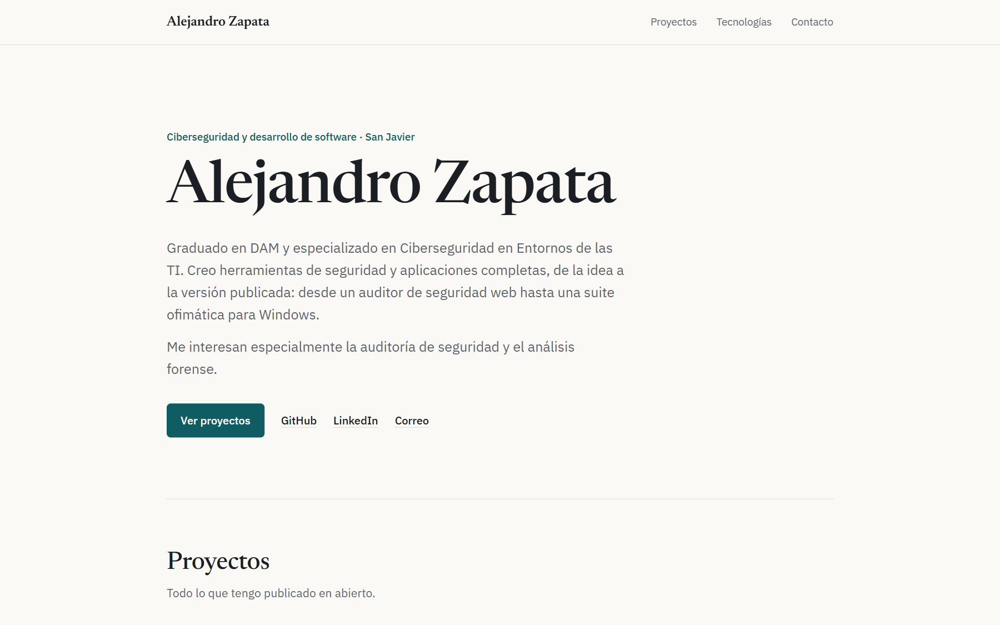
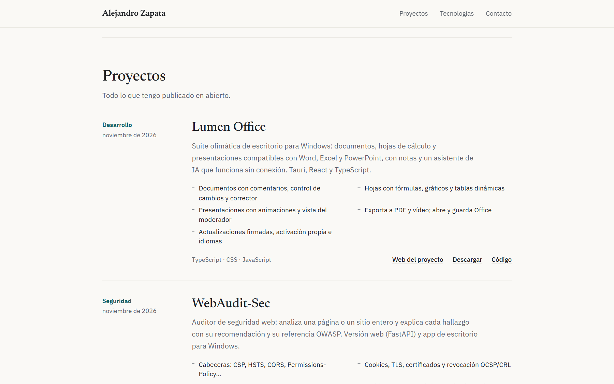
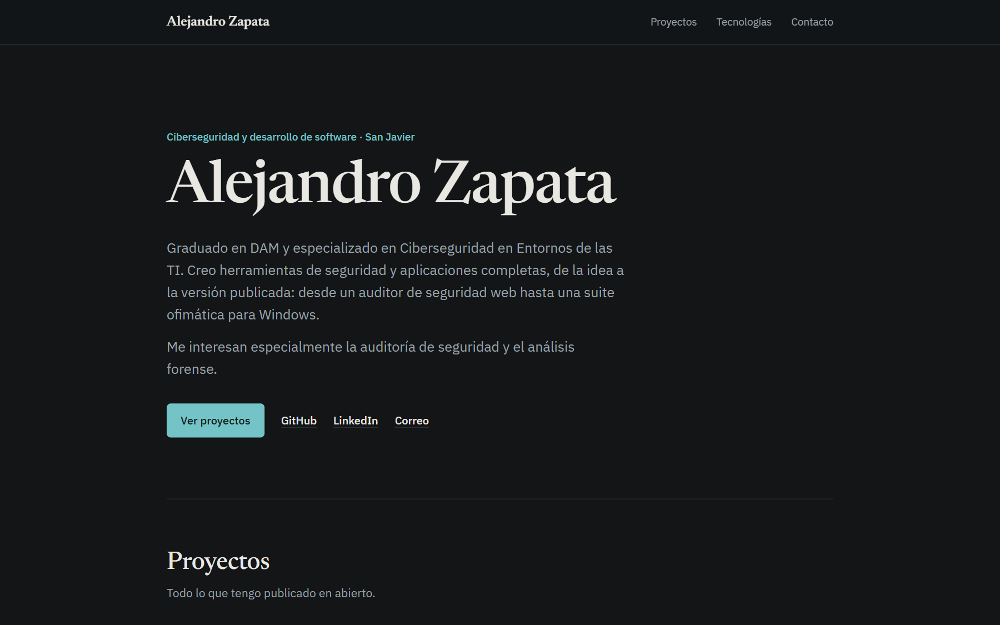
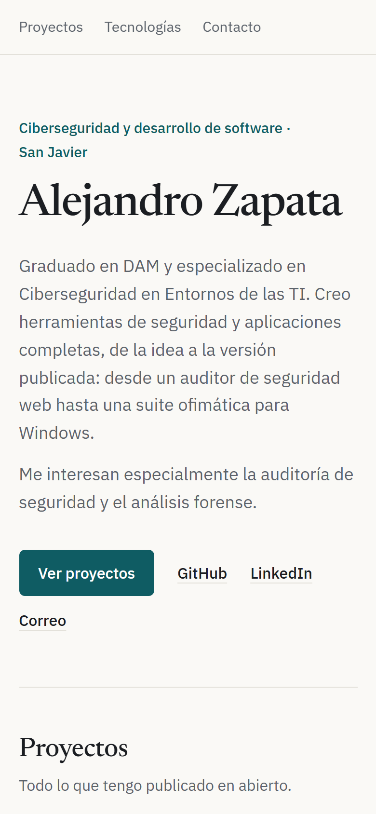

# Alejandro Zapata · Portfolio

[](https://zapermaster.github.io/web/)


Mi portfolio personal. Muestra mis proyectos públicos de GitHub **en directo**: si publico un
repositorio nuevo, aparece solo en la web.

👉 **https://zapermaster.github.io/web/**

<p align="center">
  
</p>

| Proyectos | Modo oscuro | Móvil |
|---|---|---|
|  |  |  |

## Cómo funciona

- Al cargar la página, consulta la **API pública de GitHub** y muestra cada repositorio público con
  sus lenguajes, su fecha de actualización y sus enlaces.
- Los proyectos de `ORDER` aparecen primero, en grande. El resto va a "Otros proyectos".
- Los proyectos destacados tienen una ficha propia (descripción, funcionalidades y tipo Seguridad o
  Desarrollo) definida en el objeto `EXTRA` de `index.html`. Los demás usan la descripción que tengan
  en GitHub.
- Si la API no responde (por ejemplo, por el límite de peticiones), se muestran los datos guardados
  en `FALLBACK`, así que la web nunca se queda vacía.
- Se ocultan los repositorios que no son proyectos: esta web y el del README de perfil.

## Detalles

- **Sin frameworks ni dependencias**: un único `index.html` con HTML, CSS y JavaScript.
- **Tema claro y oscuro** automático, según la configuración del sistema.
- **Adaptada al móvil** y respetuosa con `prefers-reduced-motion`.
- Publicada con **GitHub Pages** desde la rama `main`.

## Añadir o cambiar un proyecto

1. Haz público el repositorio en GitHub: aparecerá automáticamente.
2. Para darle una ficha propia, añádelo a `EXTRA` en `index.html`:

   ```js
   "MiProyecto": {
     type: "sec",                 // "sec" (Seguridad) o "dev" (Desarrollo)
     title: "Mi Proyecto",        // Opcional: nombre para mostrar
     download: true,              // Opcional: enlace a la última release
     description: "Qué hace el proyecto.",
     features: ["Funcionalidad 1", "Funcionalidad 2"]
   }
   ```

## Probarla en local

```bash
python -m http.server 8000
```

Y abre <http://localhost:8000>.

## Autor

Hecho por [Alejandro Zapata](https://github.com/ZaperMaster).
